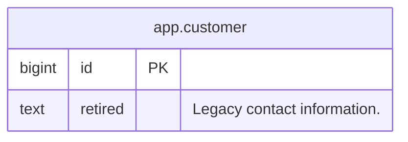

# Legacy schema

1 table(s), 2 column(s), 1 module(s).

## Diagram



## Tables

### `app.customer`

Customer records.

| Column | Type | Null | Default | Description |
|---|---|---|---|---|
| `id` **PK** | `bigint` | no | — | — |
| `retired` ~~deprecated~~ | `text` | yes | — | Legacy contact information. |

- **Primary key** `pk_customer`: `id`

## Views, procedures, functions and triggers

### `app.active_customer`

*view*

Active customers.

```sql
SELECT id FROM app.customer
```

## Roles

### `reporter`

Reporting access.

| Granted on | Permissions |
|---|---|
| `app.customer` | select |

## Do not use

These columns still exist but are on their way out.

| Column | Reason |
|---|---|
| `app.customer.retired` | Use the contact service. |

## Graveyard

Dropped objects, kept so an audit can be answered.

| Was | Dropped | By | Reason |
|---|---|---|---|
| `app.customer.legacy` | 2026-01-05 | operator | No longer collected. |
